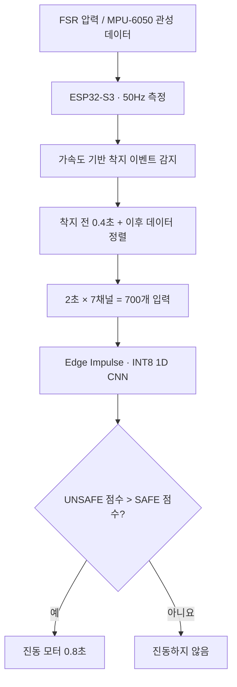
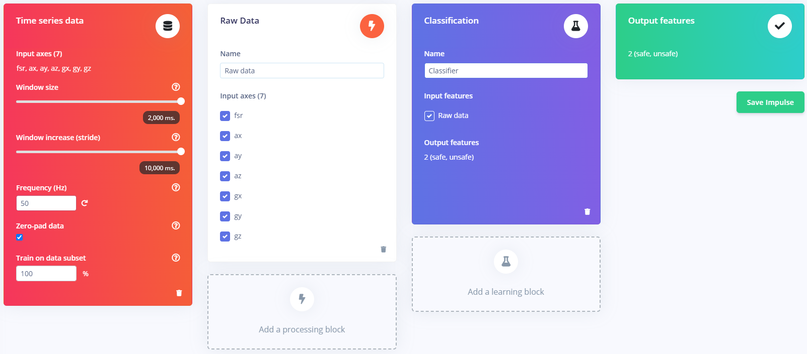
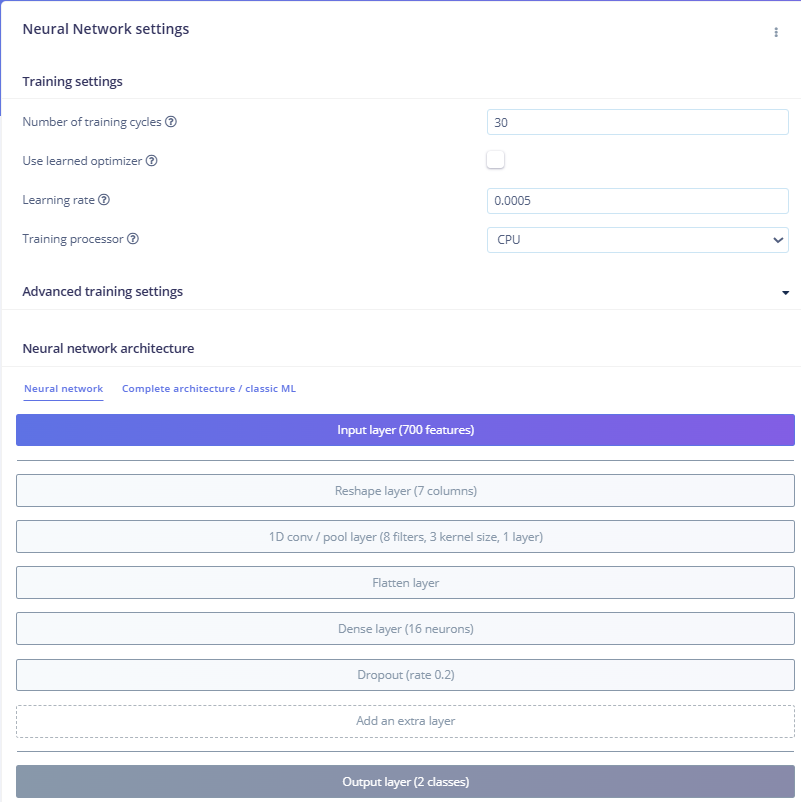
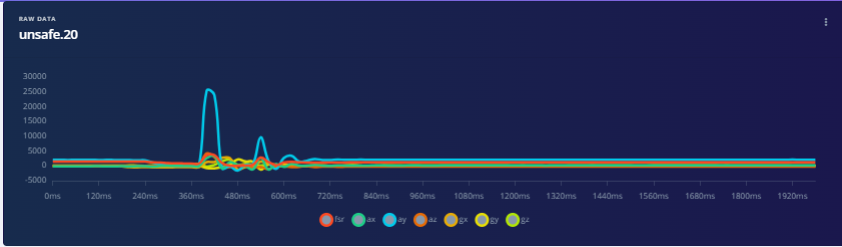
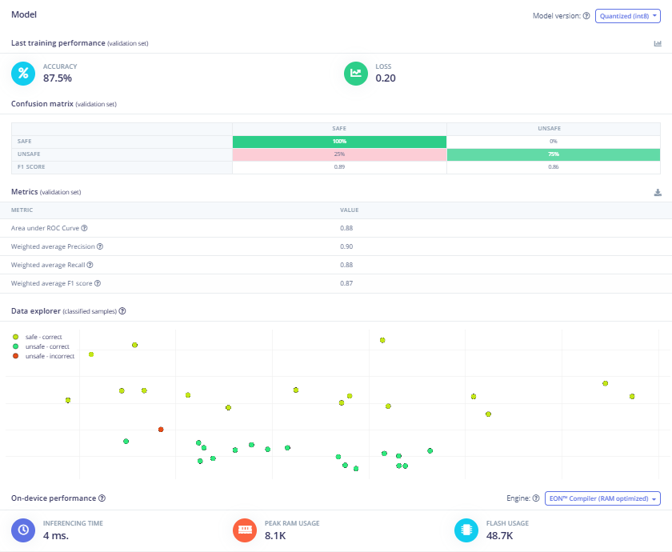
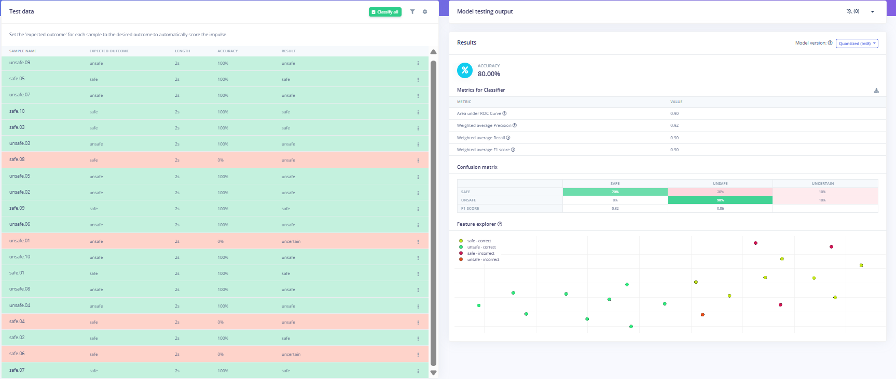
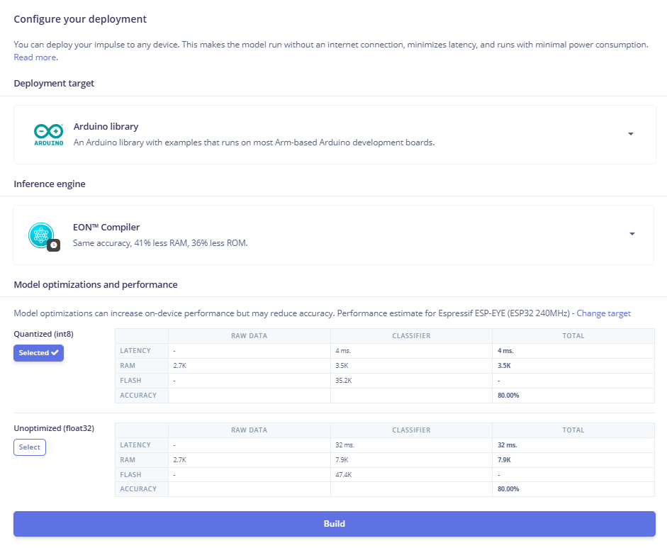

# Rescue Paw — TinyML 기반 구조견 안전 지원 스마트 부츠

> ESP32-S3에서 압력·관성 센서 데이터를 수집하고, 착지 시점을 기준으로 시계열을 정렬해 온디바이스 AI로 SAFE/UNSAFE 상태를 분류하는 실험형 프로토타입

**프로젝트 기간** 2026.06.30 ~ 2026.08.11  
**활동** 2026 ICT 스마트 디바이스 전국 공모전 · 본선 진출  
**담당 역할** PM 및 임베디드 하드웨어·TinyML 개발  
**개발 단계** 센서 데이터 수집, 모델 학습·검증, MCU 추론 및 진동 알림까지 구현한 PoC

## 1. 프로젝트 배경과 개발 목표

구조견이 위험한 지면을 밟았을 때, 압력과 움직임 변화로 이를 감지하고 착용 장치에서 진동 알림을 제공하는 스마트 부츠를 구상했습니다.

공모전 팀에서 기술 구현을 담당한 공학 전공자가 한 명이었던 만큼, 저는 PM으로서 심사기준과 구성원의 강점에 맞춰 역할을 분담하는 동시에 센서·AI 부분을 직접 개발했습니다. 기술의 실현 가능성을 확인하기 위해 ESP32-S3 기반의 데이터 수집·추론 프로토타입을 제작했습니다.

**실제 구조견 착용 시험이나 현장 위험 지면 검증을 완료한 제품은 아닙니다.** 본 프로젝트의 SAFE/UNSAFE는 실험에서 정의한 시계열 데이터의 분류 라벨입니다.

## 2. 담당한 구현 범위

| 영역 | 직접 수행한 작업 |
| --- | --- |
| 센서·MCU | ESP32-S3, FSR 압력센서, MPU-6050 가속도·자이로 데이터 수집 |
| 데이터 구축 | 50Hz 시계열 수집, CSV 저장, SAFE/UNSAFE 라벨링 및 Edge Impulse 업로드 |
| 이벤트 처리 | 가속도 크기 기반 착지 감지, 이전 0.4초 링버퍼, 2초 입력 정렬 |
| TinyML | Edge Impulse에서 1D CNN 학습·검증, INT8 양자화 모델 구성 |
| 디바이스 동작 | 추론 결과에 따른 GPIO8 진동 모터 제어, 디버그 시리얼 출력 |
| 프로젝트 운영 | 일정·역할 조정, 외부 엔지니어 자문, 발표 준비 및 공모전 본선 진출 |

## 3. 하드웨어와 시스템 구조

- **MCU:** ESP32-S3
- **압력:** FSR-402 계열 압력센서 (ADC, 예제 코드 `GPIO1`)
- **관성:** MPU-6050 (3축 가속도 + 3축 자이로, I2C `SDA=GPIO11`, `SCL=GPIO12`, 주소 `0x68`)
- **출력:** 진동 모터 제어 (`GPIO8`)
- **통신/기록:** USB 시리얼 115200bps, Python `pyserial`로 CSV 기록



**프로토타입 실행 방식:** 시리얼 모니터에서 `S` 명령을 입력하면 보정·착지 감지·추론을 **한 회차** 실행합니다. 구조견 착용 상태에서 상시 자동 감지하는 펌웨어는 아닙니다.

## 4. 시계열 데이터 수집과 모델 설계



| 항목 | 값 |
| --- | --- |
| 입력 축 | `fsr, ax, ay, az, gx, gy, gz` (7개) |
| 주파수 | 50Hz (20ms 간격) |
| 입력 길이 | 2초, 100개 시점 |
| 모델 입력 | 700개 원시값 |
| 처리 블록 | Raw Data |
| 분류 클래스 | `safe` / `unsafe` |
| 데이터셋 | Edge Impulse Studio 화면 기준 56개 (학습 36 / 테스트 20) |

데이터의 시간적 변화를 학습하기 위해 **1D CNN**을 적용했습니다.



모델 구조: `Reshape(7열) → Conv1D(8 filters, kernel 3) → Flatten → Dense(16) → Dropout(0.2) → 2-class output`  
학습 설정: **30 epochs**, 학습률 **0.0005**.

원시 센서 데이터 예시:



그래프의 급격한 센서 변화는 실험에서 기록된 값이며, 이것만으로 특정 실제 위험지면 상태나 구조견의 반응을 확인했다고 볼 수는 없습니다.

## 5. 모델 검증과 배포 설정

### 검증 데이터 결과 (Validation)



**검증 정확도 87.5%, Loss 0.20** (INT8 모델, Edge Impulse 화면 기준).

### 독립 테스트 데이터 결과 (Model testing)



테스트 데이터 20개 중 **16개 정답: 정확도 80.0%**.

| 실제 라벨 | SAFE 예측 | UNSAFE 예측 | 불확실 |
| --- | ---: | ---: | ---: |
| SAFE (10개) | 7 | 2 | 1 |
| UNSAFE (10개) | 0 | 9 | 1 |

위 결과는 **소규모 실험 데이터의 테스트 결과**이며 실제 현장 성능을 의미하지 않습니다. 특히 위험 상태가 불확실하게 나오는 경우와 안전 상태에서 오경보가 나는 경우를 개선할 필요가 있습니다.

### 디바이스 배포



- 형식: **Arduino library** / EON Compiler / **Quantized INT8**
- ESP-EYE(ESP32 240MHz) 프로파일의 추정치: INT8 **4ms**, float32 **32ms**
- 선택된 프로파일의 classifier RAM: INT8 **3.5KB**, float32 **7.9KB**
- 위 수치는 **ESP32-S3 실측 성능이 아닙니다.** 실제 펌웨어는 `result.timing`을 출력하도록 구성했지만 실기기 측정 로그는 별도 확보가 필요합니다.
- Edge Impulse 생성 SDK는 해당 제품의 라이선스 및 재배포 허용 범위를 확인하기 전에는 이 공개 저장소에 포함하지 않습니다.

## 6. 주요 코드 구현

### 6.1. 센서 데이터 수집

- [MPU-6050·FSR 측정 테스트](arduino/test_mpu/test_mpu.ino)
- [시리얼 CSV 기록용 Python 프로그램](scripts/serial_logger.py)
- [SAFE 예시 데이터](data/samples/safe.01.csv) / [UNSAFE 예시 데이터](data/samples/unsafe.01.csv)

예시 CSV는 로컬 보관 파일 중 각 한 개씩 선별한 것으로, **Edge Impulse Studio에 남아 있는 전체 56개 데이터셋의 완전한 사본이 아닙니다.**

### 6.2. 착지 시점 정렬과 온디바이스 추론

**[메인 Arduino 코드 (`safe_test_1.ino`)](arduino/safe_test_1/safe_test_1.ino)**

**① 착지 이벤트 감지**

- 부팅 후 `S` 명령을 받으면 약 0.5초 동안 가속도 기준 크기를 측정합니다.
- 착지 감지 임계값을 `max(기준 가속도 × 1.6, 기준 가속도 + 1200)`으로 계산합니다.
- 임계값에 도달하기 전 20개 시점(0.4초)을 링버퍼에 보관합니다.

**② 입력 데이터 정렬**

- 이벤트 이전 20개 시점 뒤에 착지 감지 시점을 배치합니다.
- 총 100개 시점을 채워 7채널 입력 배열(700개 값)을 만듭니다.
- `numpy::signal_from_buffer()`로 입력을 변환하고 `run_classifier()`를 호출합니다.

**③ 추론 결과와 진동 알림**

- 모델에서 반환된 `safe`와 `unsafe` 점수를 비교합니다.
- `unsafeScore > safeScore`이면 GPIO8을 HIGH로 전환하여 800ms 진동시키고 LOW로 복귀합니다.
- 다음 실험은 다시 `S` 명령으로 시작합니다.

**설계상 한계:** 실제 `.ino`는 두 분류 점수의 크기만 비교하므로 Edge Impulse의 **불확실(uncertain) 판정 기준을 별도로 적용하지 않습니다.** 안전장치로 발전시키려면 신뢰도 임계값, 불확실 상태 처리, 반복 측정·디바운싱을 개선해야 합니다.

## 7. 결과와 개선 과제

**구현·검증 결과**

- FSR·IMU 7채널 센서 데이터 수집 및 CSV 기록
- 착지 시점 기준 시계열 정렬과 TinyML 온디바이스 추론 코드 구현
- SAFE/UNSAFE 분류 결과를 진동 출력으로 연결하는 프로토타입 로직 구현
- Edge Impulse 검증 정확도 87.5%, 별도 테스트 정확도 80.0%
- 2026 ICT 스마트 디바이스 전국 공모전 본선 진출

**향후 개선 과제**

- 임계값과 불확실 판정 정책 개선, 더 큰 데이터셋으로 반복 실험
- 다양한 하중·착지 동작 및 노이즈 환경에서 일반화 성능 평가
- 시리얼 수동 트리거 없이 연속 감지할 수 있는 저전력 펌웨어
- 실제 장착 안정성·센서 내구성·배터리·방수 및 착용성 검증
- ESP32-S3 실기기 추론 시간과 시스템 전체 반응 지연 측정

## 8. 실행 시 참고

Arduino 코드에서 아래 헤더를 참조합니다.

```cpp
#include <RescuePaw_TinyML_v2_inferencing.h>
```

이 헤더는 Edge Impulse에서 생성된 Arduino 라이브러리에 포함됩니다. 해당 외부 라이브러리는 **라이선스 확인이 필요한 별도 의존성**이며 본 저장소에는 포함하지 않습니다. 소스코드 공개가 곧바로 제3자의 동일 모델 실행이나 재배포를 허용하는 것은 아닙니다.

하드웨어 사진 및 실제 시리얼 추론 로그는 확보 시 추가할 예정입니다. 
